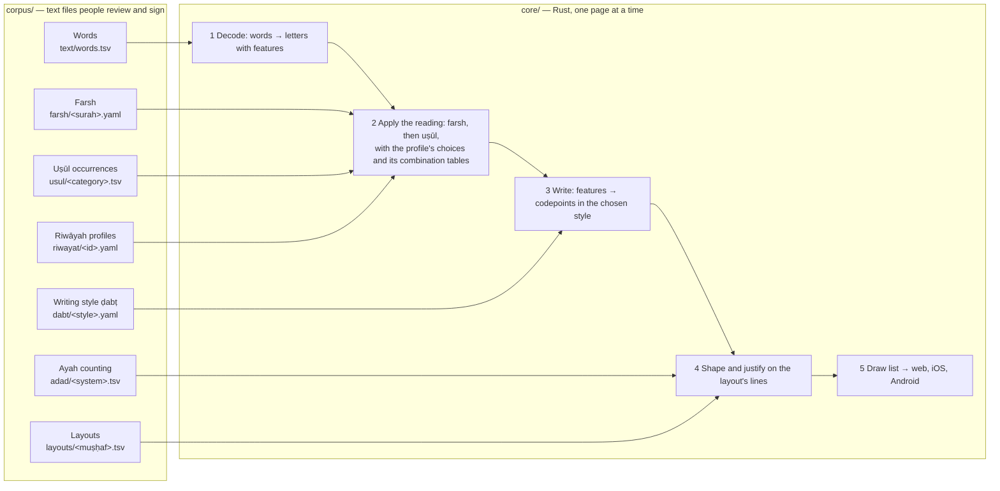

# Architecture

Accepted 2026-11-23 (D67). This file is the canonical description; the planning doc "Mushaf Lab:
Architecture Reset" (claude.ai) is the record of how it was agreed.

**In one sentence:** the qirāʾāt are stored the way the books describe them, as farsh entries,
uṣūl categories with each riwāyah's wujūh, and a writing convention, and a page is built from
those facts, one riwāyah's choices, a writing style and a layout.

## Why it replaced the patch model

The first version (now legacy, frozen) stored every riwāyah as codepoint edits against Ḥafṣ,
derived by diffing KFGQPC texts: 82,582 for Warsh alone, 31,906 of them only KFGQPC's way of
writing the sukūn. An edit recorded *what* changed, never *why*, so nobody could review it; it
needed a published text, so it had no route to the 12 riwāyāt KFGQPC doesn't publish; and the
KFGQPC muṣḥafs print only one wajh per place. Loading 120 MB of generated YAML also made every
build and test slow.

## The layers

Only step 2 knows about riwāyāt, and only step 3 knows about printing conventions. Steps 4 and 5
are the existing engine (`mushaf-shape`, `mushaf-justify`, `mushaf-layout`, `mushaf-draw`).

## The data (`corpus/`)

Exact columns are in [`formats.md`](formats.md). Each table is one kind of fact; every row has a
`source` (book + page, or a pinned file) and a `status`.

1. **Words** (`text/words.tsv`). One row per word of the Qurʾān, keyed `surah:ayah:word` (Kūfī
   count), holding the KFGQPC Ḥafṣ text exactly. Every other table points at these ids.
2. **Letters with features** (computed by `mushaf-text`, D72). Each Ḥafṣ word is decoded into
   letters carrying reading features (vowel, sukūn, shadda, tanwīn, hamza form, madd, small
   letters, signs), and encoded back byte for byte. Readings change features; writing styles draw
   them.
3. **Farsh** (`farsh/<surah>.yaml`). One entry per khilāf place: every variant with the ruwāt who
   read it, so one entry serves all 20 riwāyāt. An entry may carry a local combination table for
   the words it spans.
4. **Uṣūl occurrences** (`usul/<category>.tsv`). Every place a category applies (madd al-badal,
   munfaṣil, dhawāt al-yāʾ, naql, …), found by a detector, reviewed, then kept as rows.
   Exceptions are rows too.
5. **Riwāyah profiles** (`riwayat/<id>.yaml`). Per category: the wujūh the riwāyah has, with the
   book and page; plus riwāyah-wide combination tables. Riwāyāt of one qāriʾ share a parent file.
6. **Writing styles** (`dabt/<style>.yaml`). How features become signs in one printing tradition
   (Madinah, Maghribī, Indo-Pak, and each KFGQPC file's own conventions).
7. **Ayah counting** (`adad/<system>.tsv`). Ayah boundaries per counting system, shared by the
   riwāyāt that use it.
8. **Layouts** (`layouts/<muṣḥaf>.tsv`). Page, line, line type, first and last word, plus the page
   geometry, style and font the printing used.

### Example: Warsh's madd al-badal

Toggling badal changes one value in the reader's options for Warsh; the engine applies it to every
row of `usul/badal.tsv` on the page and checks the combination tables, so related uṣūl cannot drift
into a combination the books don't allow. The books state both kinds of table:

- **Between categories, for one riwāyah.** al-Budūr gives Warsh, on تراءى الجمعان in waqf, four
  wujūh with badal taken into account: qaṣr with fatḥ, tawassuṭ with taqlīl, and ṭūl with either
  ([Aljam3, al-Budūr p. 232](https://aljam3.com/ar/4983/12844/232)).
- **Between neighbouring words.** For Qālūn and al-Dūrī on هأنتم with هؤلاء it allows three wujūh
  and forbids madd in the first with qaṣr in the second
  ([Aljam3, al-Budūr p. 65](https://aljam3.com/ar/4983/12844/65)).

If the writing style marks madd length, the sign changes; if not, the glyphs stay and the
highlight / tap-for-detail layer shows the wajh with its source. Only lines whose width changed are
re-justified.

## Layouts

A layout is a table of lines, each a range of word ids, so lines survive a different reading. A
word both readings share keeps its line; a word a riwāyah adds or drops joins its anchor's line; a
line that still can't close tries tighter spacing within set limits, then moving one word to a
neighbouring line on the same page. A page break never moves, and anything more is reported, never
hidden. The reader picks riwāyah, layout, style and font independently; a font-coverage audit
(rule 6) decides which combinations can be drawn.

## Sources and verification (D68)

| Source | Role |
| --- | --- |
| al-Qāḍī, *al-Budūr al-Zāhira* (Shāṭibiyyah + Durrah) | source of truth |
| *al-Futūḥ al-Bāhira* (all 20 ruwāt) | source of truth |
| KFGQPC muṣḥafs (8) | check only |

1. Importers turn each book into candidate rows with page references.
2. A row both books state is `cross-source`; one only one states is `single-source`; a
   contradiction goes to the owner's review queue.
3. Owner sign-off (`cross-checked`, `muqri-verified`) lives in `data/approvals/`, per table with
   excepted rows (D70).
4. KFGQPC check: for each of the 8, set every option to the wajh KFGQPC prints; the output must
   equal its text. A mismatch is our error or a wajh our data lacks; it never overrides the books.
   Its error rate on the 8 tells us how much review the other 12 need.

Aljam3 text is OCR: a citation is checked against the page image before a row is accepted. Books
are pinned by checksum; only facts and page references are stored, never book text.

## Pipeline and engine

| Part | Language | Runs | Does |
| --- | --- | --- | --- |
| Importers (`data/pipeline/`) | Python | by hand, rarely | KFGQPC → words; layouts; books → candidate rows |
| `mushaf-text` | Rust | everywhere | letter features: decode, encode per style |
| `mushaf-corpus` (`mushaf check`, `mushaf build`) | Rust | every change | validate every table, compile `build/corpus.db` |
| Engine (`mushaf-engine` and the shaping crates) | Rust (WASM, iOS, Android) | in the app | resolve one page → shape → justify → draw list |
| Review page | web | the owner | entries awaiting sign-off, with their source |

## Storage (D69)

Line-per-fact text files in git are the source of truth; `mushaf build` compiles them into SQLite
for everything that queries. Text keeps provenance per fact (`git blame`), lets the owner review a
change as a list of rows, and is deterministic (rule 8). TSV/JSONL parse in well under a second;
YAML is kept for small hand-written files only. When several people who don't use git edit at
once, a database becomes the editing surface and exports to the same files.

## Legacy (frozen until M3)

The patch model (`data/patches/`, `data/rules/`, `data/options/`, `data/profiles/`, the legacy
`just data-build`, and `mushaf-resolve`, `mushaf-rules`, `mushaf-db`, `mushaf-roundtrip`) keeps the
current app rendering the 8 KFGQPC riwāyāt. Nothing new goes into it (rule 12). It is deleted once
the new model reproduces all 8 (M3).
