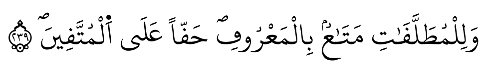
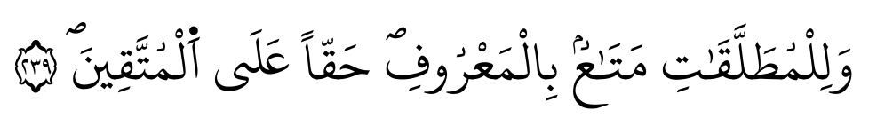
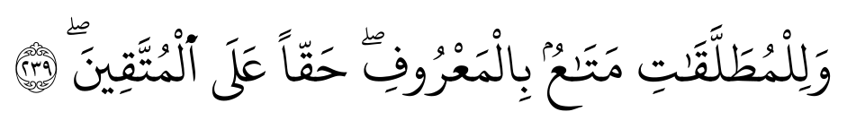

# Font coverage and shaping audit (spike S2)

Generated by `data/spikes/s2_fonts.py` from pinned sources; HarfBuzz 0.56.3 (uharfbuzz). Each KFGQPC text is shaped per ayah exactly as stored; DigitalKhatt texts per line. No text is altered.

## 1. Codepoints used by each text (excluding base letters U+0621-U+064A)

| Codepoint | Cat | Name | hafs | shuba | warsh | qalun | bazzi | qunbul | duri_abuamr | susi | DK madina text | DK oldmadina text |
|---|---|---|---|---|---|---|---|---|---|---|---|---|
| U+0020 | Zs | Space | 71196 | 71195 | 71215 | 71213 | 72784 | 71209 | 71209 | 71209 | 75300 | 75301 |
| U+00A0 | Zs | No-Break Space | 6434 | 6435 | 6648 | 6642 | 4854 | 6419 | 6650 | 6650 | 0 | 0 |
| U+034F | Mn | Combining Grapheme Joiner | 0 | 0 | 0 | 0 | 0 | 0 | 0 | 0 | 29883 | 29883 |
| U+0640 | Lm | Arabic Tatweel | 535 | 537 | 411 | 411 | 501 | 501 | 532 | 510 | 811 | 811 |
| U+064B | Mn | Arabic Fathatan | 734 | 731 | 730 | 728 | 730 | 730 | 729 | 729 | 734 | 734 |
| U+064C | Mn | Arabic Dammatan | 578 | 580 | 588 | 582 | 581 | 581 | 580 | 580 | 578 | 578 |
| U+064D | Mn | Arabic Kasratan | 599 | 600 | 603 | 599 | 597 | 597 | 597 | 597 | 606 | 606 |
| U+064E | Mn | Arabic Fatha | 122777 | 122660 | 125435 | 126402 | 122688 | 122688 | 128784 | 128280 | 123772 | 123772 |
| U+064F | Mn | Arabic Damma | 37454 | 37439 | 41080 | 40003 | 43695 | 43695 | 39816 | 39386 | 37726 | 37726 |
| U+0650 | Mn | Arabic Kasra | 46069 | 46093 | 48921 | 48782 | 46038 | 46038 | 48845 | 48627 | 46869 | 46869 |
| U+0651 | Mn | Arabic Shadda | 22678 | 22694 | 21723 | 21721 | 21878 | 21878 | 22940 | 24166 | 23062 | 23062 |
| U+0652 | Mn | Arabic Sukun | 3988 | 3982 | 37554 | 42045 | 3984 | 3985 | 3992 | 3992 | 37413 | 37413 |
| U+0653 | Mn | Arabic Maddah Above | 5652 | 5670 | 6336 | 2424 | 2380 | 2380 | 5549 | 2340 | 5380 | 5380 |
| U+0654 | Mn | Arabic Hamza Above | 495 | 498 | 622 | 706 | 474 | 473 | 515 | 492 | 11309 | 11309 |
| U+0655 | Mn | Arabic Hamza Below | 14 | 14 | 45 | 44 | 16 | 16 | 16 | 16 | 5094 | 5094 |
| U+0656 | Mn | Arabic Subscript Alef | 1935 | 1935 | 1935 | 1930 | 1928 | 1928 | 1931 | 1931 | 0 | 0 |
| U+0657 | Mn | Arabic Inverted Damma | 2901 | 2907 | 2916 | 2904 | 2901 | 2901 | 2903 | 2903 | 0 | 0 |
| U+065C | Mn | Arabic Vowel Sign Dot Below | 0 | 79 | 0 | 0 | 0 | 0 | 0 | 0 | 1 | 1 |
| U+065E | Mn | Arabic Fatha With Two Dots | 1807 | 1807 | 1815 | 1809 | 1807 | 1807 | 1806 | 1806 | 0 | 0 |
| U+0660 | Nd | Arabic-Indic Digit Zero | 0 | 0 | 0 | 0 | 774 | 0 | 0 | 0 | 778 | 778 |
| U+0661 | Nd | Arabic-Indic Digit One | 0 | 0 | 0 | 0 | 2541 | 0 | 0 | 0 | 2548 | 2548 |
| U+0662 | Nd | Arabic-Indic Digit Two | 0 | 1 | 0 | 0 | 1637 | 0 | 0 | 0 | 1643 | 1643 |
| U+0663 | Nd | Arabic-Indic Digit Three | 0 | 0 | 0 | 0 | 1345 | 0 | 0 | 0 | 1347 | 1347 |
| U+0664 | Nd | Arabic-Indic Digit Four | 0 | 0 | 0 | 0 | 1241 | 0 | 0 | 0 | 1244 | 1244 |
| U+0665 | Nd | Arabic-Indic Digit Five | 0 | 0 | 0 | 0 | 1132 | 0 | 0 | 0 | 1139 | 1139 |
| U+0666 | Nd | Arabic-Indic Digit Six | 0 | 1 | 0 | 0 | 1039 | 0 | 0 | 0 | 1043 | 1043 |
| U+0667 | Nd | Arabic-Indic Digit Seven | 0 | 0 | 0 | 0 | 978 | 0 | 0 | 0 | 986 | 986 |
| U+0668 | Nd | Arabic-Indic Digit Eight | 0 | 1 | 0 | 0 | 899 | 0 | 0 | 0 | 909 | 909 |
| U+0669 | Nd | Arabic-Indic Digit Nine | 0 | 0 | 0 | 0 | 842 | 0 | 0 | 0 | 834 | 834 |
| U+066E | Lo | Arabic Letter Dotless Beh | 0 | 0 | 0 | 0 | 1 | 1 | 0 | 0 | 0 | 0 |
| U+0670 | Mn | Arabic Letter Superscript Alef | 9726 | 9743 | 10033 | 9925 | 9706 | 9707 | 9788 | 9810 | 9842 | 9842 |
| U+0671 | Lo | Arabic Letter Alef Wasla | 13483 | 13486 | 0 | 0 | 13490 | 13490 | 0 | 0 | 13819 | 13819 |
| U+06D2 | Lo | Arabic Letter Yeh Barree | 0 | 0 | 2996 | 3003 | 0 | 0 | 0 | 0 | 0 | 0 |
| U+06D6 | Mn | Arabic Small High Ligature Sad With Lam With Alef Maksura | 1651 | 1650 | 9948 | 9948 | 1644 | 1645 | 1653 | 1642 | 1651 | 1681 |
| U+06D7 | Mn | Arabic Small High Ligature Qaf With Lam With Alef Maksura | 511 | 511 | 0 | 0 | 505 | 505 | 572 | 517 | 511 | 603 |
| U+06D8 | Mn | Arabic Small High Meem Initial Form | 21 | 21 | 0 | 0 | 22 | 22 | 23 | 22 | 21 | 22 |
| U+06D9 | Mn | Arabic Small High Lam Alef | 0 | 0 | 0 | 0 | 0 | 0 | 0 | 0 | 0 | 68 |
| U+06DA | Mn | Arabic Small High Jeem | 2083 | 2083 | 0 | 0 | 2092 | 2096 | 2061 | 2096 | 2083 | 1972 |
| U+06DB | Mn | Arabic Small High Three Dots | 6 | 6 | 0 | 0 | 6 | 6 | 6 | 6 | 6 | 12 |
| U+06DC | Mn | Arabic Small High Seen | 8 | 1 | 0 | 0 | 1 | 1 | 2 | 2 | 7 | 7 |
| U+06DD | Cf | Arabic End Of Ayah | 0 | 0 | 0 | 0 | 0 | 0 | 0 | 0 | 6236 | 6236 |
| U+06DE | So | Arabic Start Of Rub El Hizb | 199 | 199 | 435 | 428 | 199 | 199 | 433 | 433 | 199 | 199 |
| U+06DF | Mn | Arabic Small High Rounded Zero | 0 | 0 | 281 | 177 | 46 | 46 | 170 | 170 | 3988 | 3988 |
| U+06E0 | Mn | Arabic Small High Upright Rectangular Zero | 66 | 62 | 0 | 0 | 65 | 65 | 64 | 64 | 66 | 66 |
| U+06E1 | Mn | Arabic Small High Dotless Head Of Khah | 37148 | 37147 | 0 | 0 | 32143 | 32144 | 37176 | 36060 | 0 | 0 |
| U+06E2 | Mn | Arabic Small High Meem Isolated Form | 510 | 510 | 575 | 611 | 508 | 508 | 608 | 608 | 510 | 510 |
| U+06E3 | Mn | Arabic Small Low Seen | 0 | 0 | 0 | 0 | 0 | 0 | 0 | 0 | 1 | 1 |
| U+06E4 | Mn | Arabic Small High Madda | 26 | 26 | 0 | 0 | 26 | 26 | 26 | 26 | 0 | 0 |
| U+06E5 | Lm | Arabic Small Waw | 1256 | 1255 | 2142 | 1254 | 8037 | 8037 | 1259 | 1230 | 1256 | 1256 |
| U+06E6 | Lm | Arabic Small Yeh | 957 | 949 | 1006 | 967 | 1431 | 1431 | 984 | 978 | 957 | 957 |
| U+06E7 | Mn | Arabic Small High Yeh | 38 | 39 | 22 | 24 | 24 | 24 | 38 | 38 | 38 | 38 |
| U+06E8 | Mn | Arabic Small High Noon | 1 | 0 | 2 | 2 | 2 | 2 | 2 | 2 | 1 | 1 |
| U+06E9 | So | Arabic Place Of Sajdah | 15 | 15 | 14 | 12 | 15 | 15 | 15 | 15 | 15 | 15 |
| U+06EA | Mn | Arabic Empty Centre Low Stop | 1 | 0 | 2569 | 696 | 57 | 57 | 1434 | 1306 | 0 | 0 |
| U+06EC | Mn | Arabic Rounded High Stop With Filled Centre | 2 | 3 | 10055 | 10087 | 56 | 56 | 10052 | 10053 | 2 | 2 |
| U+06ED | Mn | Arabic Small Low Meem | 99 | 100 | 0 | 0 | 100 | 100 | 626 | 593 | 99 | 99 |
| U+08F0 | Mn | Arabic Open Fathatan | 0 | 0 | 0 | 0 | 0 | 0 | 0 | 0 | 2901 | 2901 |
| U+08F1 | Mn | Arabic Open Dammatan | 0 | 0 | 0 | 0 | 0 | 0 | 0 | 0 | 1807 | 1807 |
| U+08F2 | Mn | Arabic Open Kasratan | 0 | 0 | 0 | 0 | 0 | 0 | 0 | 0 | 1935 | 1935 |
| U+08F3 | Mn | Arabic Small High Waw | 0 | 0 | 0 | 0 | 0 | 0 | 0 | 0 | 1 | 1 |
| U+200D | Cf | Zero Width Joiner | 0 | 0 | 0 | 0 | 0 | 0 | 1 | 1 | 0 | 0 |
| U+200F | Cf | Right-To-Left Mark | 0 | 0 | 14 | 14 | 0 | 0 | 0 | 0 | 0 | 0 |

Plus 286 codepoints in U+FC00-U+FDFF, which KFGQPC v2 uses as ayah-number signs (U+FC00 + n - 1). Per text: hafs 286, shuba 285, warsh 285, qalun 285, bazzi 0, qunbul 285, duri_abuamr 285, susi 285, DK madina text 0, DK oldmadina text 0.

## 2. Fonts

| Font | File | Glyph classes: marks | Variable axes | OpenType features |
|---|---|---|---|---|
| KFGQPC hafs | `uthmanic_hafs_v20.ttf` | 60 | — | calt curs fina init kern liga mark medi mkmk rlig zz01 zz02 zz03 zz04 zz05 zz06 zz07 zz08 zz09 zz10 zz11 zz12 zz13 zz14 zz15 zz16 zz17 zz18 zz19 zz20 zz21 zz22 zz23 zz24 zz25 zz26 zz27 zz28 zz29 zz30 zz31 zz32 zz33 zz34 zz35 zz36 zz37 zz38 zz39 zz40 zz41 zz42 zz43 zz44 zz45 zz46 zz47 zz48 zz49 zz50 zz51 zz52 zz53 zz54 zz55 zz56 zz57 zz58 zz59 zz60 zz61 zz62 zz63 zz64 zz65 zz66 zz67 zz68 zz69 |
| KFGQPC shuba | `uthmanic_shuba_v20.ttf` | 44 | — | calt curs fina init liga mark medi mkmk rlig zz01 zz02 zz03 zz04 zz05 zz06 zz07 zz08 zz09 zz10 zz11 zz12 zz13 zz14 zz15 zz16 zz17 zz18 zz19 zz20 zz21 zz22 zz23 zz24 zz25 zz26 zz27 zz28 zz29 zz30 zz31 zz32 zz33 zz34 zz35 zz36 |
| KFGQPC warsh | `uthmanic_warsh_v21.ttf` | 38 | — | calt curs fina init liga mark medi mkmk rlig zz01 zz02 zz03 zz04 zz05 zz06 zz07 zz08 zz09 zz10 zz11 zz12 zz13 zz14 zz15 zz16 zz17 zz18 zz19 zz20 zz21 zz22 zz23 zz24 zz25 zz26 zz27 zz28 zz29 zz30 zz31 zz32 zz33 zz34 zz35 |
| KFGQPC qalun | `uthmanic_qaloun_v21.ttf` | 38 | — | calt curs fina init liga mark medi mkmk rlig zz01 zz02 zz03 zz04 zz05 zz06 zz07 zz08 zz09 zz10 zz11 zz12 zz13 zz14 zz15 zz16 zz17 zz18 zz19 zz20 zz21 zz22 zz23 zz24 zz25 zz26 zz27 zz28 zz29 zz30 zz31 zz32 zz33 zz34 zz35 |
| KFGQPC qunbul | `uthmanic_qunbul_v20.ttf` | 45 | — | calt curs fina init liga mark medi mkmk rlig zz01 zz02 zz03 zz04 zz05 zz06 zz07 zz08 zz09 zz10 zz11 zz12 zz13 zz14 zz15 zz16 zz17 zz18 zz19 zz20 zz21 zz22 zz23 zz24 zz25 zz26 zz27 zz28 zz29 zz30 zz31 zz32 zz33 zz34 zz35 zz36 zz37 |
| KFGQPC duri_abuamr | `uthmanic_douri_v20.ttf` | 46 | — | calt curs fina init liga mark medi mkmk rlig zz01 zz02 zz03 zz04 zz05 zz06 zz07 zz08 zz09 zz10 zz11 zz12 zz13 zz14 zz15 zz16 zz17 zz18 zz19 zz20 zz21 zz22 zz23 zz24 zz25 zz26 zz27 zz28 zz29 zz30 zz31 zz32 zz33 zz34 zz35 zz36 zz37 |
| KFGQPC susi | `uthmanic_sousi_v20.ttf` | 46 | — | calt curs fina init liga mark medi mkmk rlig zz01 zz02 zz03 zz04 zz05 zz06 zz07 zz08 zz09 zz10 zz11 zz12 zz13 zz14 zz15 zz16 zz17 zz18 zz19 zz20 zz21 zz22 zz23 zz24 zz25 zz26 zz27 zz28 zz29 zz30 zz31 zz32 zz33 zz34 zz35 zz36 zz37 |
| KFGQPC bazzi (mirror v7) | `bazzi.7.ttf` | 45 | — | calt curs fina init liga mark medi mkmk rlig |
| DigitalKhatt madina | `madina.otf` | 59 | LTAT, RTAT | basm ccmp curs cv01 cv02 cv03 cv10 cv11 cv12 cv13 cv14 cv15 cv16 cv17 cv18 fina init jalt kern mark medi mkmk rclt rlig sch1 shr1 shr2 shrr ss01 |
| DigitalKhatt oldmadina | `oldmadina.otf` | 84 | — | basm bism calt ccmp curs cv01 cv02 cv03 cv04 cv10 cv11 cv12 cv13 cv14 cv15 cv16 cv17 cv18 cv19 fina init kern mark medi mkmk rclt rlig |

## 3. Shaping audit

| Text | Font | Missing from cmap | .notdef | Dotted circles | Unattached marks |
|---|---|---|---|---|---|
| hafs | KFGQPC hafs | 0 | 0 | 0 | **9** (U+0631x3, U+0629x3, U+064Ax1, U+0646x1, U+0645x1) |
| shuba | KFGQPC shuba | 0 | 0 | 0 | **9** (U+0631x3, U+0629x3, U+064Ax1, U+0646x1, U+0645x1) |
| warsh | KFGQPC warsh | 0 | 0 | 0 | **60** (U+0645x43, U+0627x7, U+0646x3, U+0629x3, U+0631x2, U+0638x1, …) |
| qalun | KFGQPC qalun | 0 | 0 | 0 | **142** (U+0645x107, U+0627x14, U+0638x6, U+0646x4, U+0629x4, U+0631x3, …) |
| bazzi | KFGQPC bazzi (mirror v7) | 0 | 0 | 0 | **11** (U+0631x3, U+0629x3, U+0627x2, U+064Ax1, U+0646x1, U+0645x1) |
| qunbul | KFGQPC qunbul | 0 | 0 | 0 | **11** (U+0631x3, U+0629x3, U+0627x2, U+064Ax1, U+0646x1, U+0645x1) |
| duri_abuamr | KFGQPC duri_abuamr | 0 | 0 | 0 | **7** (U+0629x3, U+0627x1, U+064Ax1, U+0646x1, U+0645x1) |
| susi | KFGQPC susi | 0 | 0 | 0 | **6** (U+0629x3, U+0627x1, U+0646x1, U+0645x1) |
| hafs | DigitalKhatt madina | **12906** (ٗx2901, ٖx1935, ٞx1807, ﰀx114, ﰁx114, ﰂx114, …) | **12906** (U+0631x1009, U+0629x991, U+0645x792, U+0644x605, U+062Fx482, U+0646x428, …) | 0 | **408** (U+0629x135, U+0621x36, U+0631x34, U+0645x27, U+062Fx25, U+062Ax22, …) |
| hafs | DigitalKhatt oldmadina | **12906** (ٗx2901, ٖx1935, ٞx1807, ﰀx114, ﰁx114, ﰂx114, …) | **12906** (U+0631x1009, U+0629x991, U+0645x792, U+0644x605, U+062Fx482, U+0646x428, …) | 0 | **408** (U+0629x135, U+0621x36, U+0631x34, U+0645x27, U+062Fx25, U+062Ax22, …) |
| shuba | KFGQPC hafs | 0 | 0 | 0 | **15** (U+0631x9, U+0629x3, U+064Ax1, U+0646x1, U+0645x1) |
| shuba | DigitalKhatt madina | **12910** (ٗx2907, ٖx1935, ٞx1807, ﰀx114, ﰁx114, ﰂx114, …) | **12910** (U+0631x1010, U+0629x992, U+0645x793, U+0644x604, U+062Fx485, U+0646x429, …) | 0 | **410** (U+0629x135, U+0621x36, U+0631x34, U+062Fx27, U+0645x27, U+062Ax22, …) |
| shuba | DigitalKhatt oldmadina | **12910** (ٗx2907, ٖx1935, ٞx1807, ﰀx114, ﰁx114, ﰂx114, …) | **12910** (U+0631x1010, U+0629x992, U+0645x793, U+0644x604, U+062Fx485, U+0646x429, …) | 0 | **410** (U+0629x135, U+0621x36, U+0631x34, U+062Fx27, U+0645x27, U+062Ax22, …) |
| warsh | KFGQPC hafs | 0 | 0 | 0 | **650** (U+06D2x645, U+0629x3, U+0638x1, U+0637x1) |
| warsh | DigitalKhatt madina | **18459** (ےx2996, ٗx2916, ۪x2569, ٖx1935, ٞx1815, ﰀx114, …) | **18445** (U+0627x3049, U+06D2x3000, U+0629x988, U+0631x803, U+0645x571, U+0644x459, …) | 0 | **2189** (U+0627x866, U+0645x278, U+0629x180, U+0631x165, U+0646x134, U+062Fx89, …) |
| warsh | DigitalKhatt oldmadina | **18459** (ےx2996, ٗx2916, ۪x2569, ٖx1935, ٞx1815, ﰀx114, …) | **18445** (U+0627x3049, U+06D2x3000, U+0629x988, U+0631x803, U+0645x571, U+0644x459, …) | 0 | **2189** (U+0627x866, U+0645x278, U+0629x180, U+0631x165, U+0646x134, U+062Fx89, …) |
| qalun | KFGQPC hafs | 0 | 0 | 0 | **406** (U+06D2x363, U+0631x34, U+0629x4, U+0627x2, U+0637x2, U+0638x1) |
| qalun | DigitalKhatt madina | **16570** (ےx3003, ٗx2904, ٖx1930, ٞx1809, ۪x696, ﰀx114, …) | **16556** (U+0627x3037, U+06D2x3007, U+0629x987, U+0631x535, U+0645x527, U+0644x298, …) | 0 | **2135** (U+0627x858, U+0645x275, U+0629x179, U+0631x159, U+0646x131, U+062Fx87, …) |
| qalun | DigitalKhatt oldmadina | **16570** (ےx3003, ٗx2904, ٖx1930, ٞx1809, ۪x696, ﰀx114, …) | **16556** (U+0627x3037, U+06D2x3007, U+0629x987, U+0631x535, U+0645x527, U+0644x298, …) | 0 | **2135** (U+0627x858, U+0645x275, U+0629x179, U+0631x159, U+0646x131, U+062Fx87, …) |
| bazzi | KFGQPC hafs | 0 | 0 | 0 | **11** (U+0631x3, U+0629x3, U+0627x2, U+064Ax1, U+0646x1, U+0645x1) |
| bazzi | DigitalKhatt madina | **6720** (ٗx2901, ٖx1928, ٞx1807, ۪x57, ۤx26, ٮx1) | **6720** (U+0631x1011, U+0629x990, U+0645x790, U+0644x603, U+062Fx486, U+0646x429, …) | 0 | **412** (U+0629x134, U+0621x36, U+0631x34, U+0645x27, U+062Fx25, U+062Ax22, …) |
| bazzi | DigitalKhatt oldmadina | **6720** (ٗx2901, ٖx1928, ٞx1807, ۪x57, ۤx26, ٮx1) | **6720** (U+0631x1011, U+0629x990, U+0645x790, U+0644x603, U+062Fx486, U+0646x429, …) | 0 | **412** (U+0629x134, U+0621x36, U+0631x34, U+0645x27, U+062Fx25, U+062Ax22, …) |
| qunbul | KFGQPC hafs | 0 | 0 | 0 | **11** (U+0631x3, U+0629x3, U+0627x2, U+064Ax1, U+0646x1, U+0645x1) |
| qunbul | DigitalKhatt madina | **12940** (ٗx2901, ٖx1928, ٞx1807, ﰀx114, ﰁx114, ﰂx114, …) | **12940** (U+0631x1011, U+0629x990, U+0645x790, U+0644x603, U+062Fx486, U+0646x429, …) | 0 | **411** (U+0629x134, U+0621x36, U+0631x33, U+0645x27, U+062Fx25, U+062Ax22, …) |
| qunbul | DigitalKhatt oldmadina | **12940** (ٗx2901, ٖx1928, ٞx1807, ﰀx114, ﰁx114, ﰂx114, …) | **12940** (U+0631x1011, U+0629x990, U+0645x790, U+0644x603, U+062Fx486, U+0646x429, …) | 0 | **411** (U+0629x134, U+0621x36, U+0631x33, U+0645x27, U+062Fx25, U+062Ax22, …) |
| duri_abuamr | KFGQPC hafs | **1** (آx1) | 0 | 0 | **6** (U+0629x3, U+0633x1, U+0623x1, U+064Ax1) |
| duri_abuamr | DigitalKhatt madina | **14317** (ٗx2903, ٖx1931, ٞx1806, ۪x1434, ﰀx114, ﰁx114, …) | **14317** (U+0631x1265, U+0629x989, U+0645x794, U+0627x698, U+0646x661, U+0644x603, …) | 0 | **426** (U+0629x133, U+0631x39, U+0621x36, U+0645x27, U+062Fx26, U+062Ax22, …) |
| duri_abuamr | DigitalKhatt oldmadina | **14317** (ٗx2903, ٖx1931, ٞx1806, ۪x1434, ﰀx114, ﰁx114, …) | **14317** (U+0631x1265, U+0629x989, U+0645x794, U+0627x698, U+0646x661, U+0644x603, …) | 0 | **426** (U+0629x133, U+0631x39, U+0621x36, U+0645x27, U+062Fx26, U+062Ax22, …) |
| susi | KFGQPC hafs | **1** (آx1) | 0 | 0 | **5** (U+0629x3, U+0633x1, U+0623x1) |
| susi | DigitalKhatt madina | **14189** (ٗx2903, ٖx1931, ٞx1806, ۪x1306, ﰀx114, ﰁx114, …) | **14189** (U+0631x1288, U+0629x989, U+0645x794, U+0627x698, U+0644x603, U+0646x510, …) | 0 | **426** (U+0629x134, U+0631x39, U+0621x36, U+0645x27, U+062Fx25, U+062Ax22, …) |
| susi | DigitalKhatt oldmadina | **14189** (ٗx2903, ٖx1931, ٞx1806, ۪x1306, ﰀx114, ﰁx114, …) | **14189** (U+0631x1288, U+0629x989, U+0645x794, U+0627x698, U+0644x603, U+0646x510, …) | 0 | **426** (U+0629x134, U+0631x39, U+0621x36, U+0645x27, U+062Fx25, U+062Ax22, …) |
| DK madina text | DigitalKhatt madina | 0 | 0 | 0 | 0 |
| DK oldmadina text | DigitalKhatt oldmadina | 0 | 0 | 0 | 0 |

## 4. Encoding conventions: KFGQPC Hafs v2.0 vs DigitalKhatt madina text

S1 showed both texts have the same letters. Here every word with the same skeleton is split into clusters (base letter + attached codepoints) and the clusters are compared one to one. A KFGQPC cluster that always corresponds to the same DigitalKhatt cluster can be converted by a fixed table; one with several counterparts depends on context.

Aligned words: 77405; identical codepoint for codepoint: 30237.
Aligned clusters: 322620; identical: 257284.

Distinct differing KFGQPC cluster forms: 444; with exactly one DigitalKhatt counterpart: 443; with several: 1.

Most frequent differing forms (codepoints in hex, base letter first):

| KFGQPC cluster | Occurrences | DigitalKhatt counterparts (count) |
|---|---|---|
| `0623 064E` | 7495 | `0627 034F 0654 034F 064E` (7495) |
| `0644 06E1` | 7303 | `0644 0652` (7096); `0644 0652 0640 0654 034F 064E` (207) |
| `0645 06E1` | 5589 | `0645 0652` (5589) |
| `0625 0650` | 5042 | `0627 0655 034F 0650` (5042) |
| `0627 0652` | 3565 | `0627 06DF` (3565) |
| `064A 06E1` | 2994 | `064A 0652` (2994) |
| `0648 06E1` | 2393 | `0648 0652` (2393) |
| `0639 06E1` | 2006 | `0639 0652` (2006) |
| `0631 06E1` | 1737 | `0631 0652` (1737) |
| `0646 06E1` | 1710 | `0646 0652` (1710) |
| `0627 0653` | 1633 | `0627 034F 0653` (1633) |
| `0633 06E1` | 1211 | `0633 0652` (1211) |
| `0628 06E1` | 1127 | `0628 0652` (1127) |
| `062D 06E1` | 998 | `062D 0652` (998) |
| `062F 06E1` | 951 | `062F 0652` (951) |
| `0623 064F` | 855 | `0627 034F 0654 034F 064F` (855) |
| `0626 0650` | 673 | `064A 034F 0654 034F 0650` (673) |
| `062A 06E1` | 668 | `062A 0652` (668) |
| `062C 06E1` | 655 | `062C 0652` (655) |
| `0643 06E1` | 646 | `0643 0652` (646) |
| `0641 06E1` | 634 | `0641 0652` (634) |
| `0647 06E1` | 564 | `0647 0652` (564) |
| `0627 0653 0621 064E` | 557 | `0627 034F 0653 0621 064E` (557) |
| `062E 06E1` | 549 | `062E 0652` (549) |
| `0624 06E1` | 515 | `0648 034F 0654 034F 0652` (515) |
| `0642 06E1` | 515 | `0642 0652` (515) |
| `0623 06E1` | 485 | `0627 034F 0654 034F 0652` (485) |
| `0630 06E1` | 477 | `0630 0652` (477) |
| `0631 0657` | 451 | `0631 08F0` (451) |
| `0634 06E1` | 411 | `0634 0652` (411) |
| `0635 06E1` | 390 | `0635 0652` (390) |
| `063A 06E1` | 353 | `063A 0652` (353) |
| `0629 0657` | 351 | `0629 08F0` (351) |
| `0631 065E` | 319 | `0631 08F1` (319) |
| `0644 0657` | 286 | `0644 08F0` (286) |
| `0645 065E` | 281 | `0645 08F1` (281) |
| `0645 06E1 06DA` | 279 | `0645 0652 06DA` (279) |
| `0623 0653` | 277 | `0627` (277) |
| `0629 0656` | 260 | `0629 08F2` (260) |
| `062F 0657` | 256 | `062F 08F0` (256) |

## 5. Letterforms: Warsh and Qalun text in their own fonts vs the Hafs font

Sample: Warsh 2:239 as stored. Rendered with `hb-view` (no justification). Compare the dots of feh/qaf and final yeh.

KFGQPC warsh:

KFGQPC qalun:

KFGQPC hafs:

